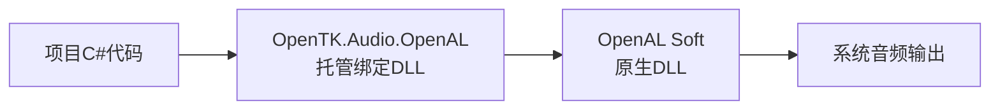

# 依赖、版本锁定与素材合同

本页维护精确依赖、获取与部署步骤、选型理由及受控升级方法。新电脑的主线是从空白C#工程开始：先把环境、包、外部素材和全部项目自有非C#资源准备齐，再只写C#复原当前V1，不以clone仓库为前提。原工程准备历史按页末日期索引追溯；当前任务/同步状态查 [status.md](../status.md)，操作分工见 [agent-workflow.md](../agent-workflow.md)。

<a id="acquisition-map"></a>

## 1 新电脑要获取哪些东西

首次搭建按 [reproduction.md](reproduction.md#new-machine-setup) 的顺序进行。下面主线不假定新电脑已有项目配置、锁文件、assets或准备脚本；右列单独说明已经取得原工程文件时的可选路径。本文是搭建说明，本轮没有在新电脑执行安装、还原、转换或运行。

| 获取类别                | 从空白工程开始的主线                                                                                                                                                  | 已有原工程文件时的可选路径                                                          |
| ----------------------- | --------------------------------------------------------------------------------------------------------------------------------------------------------------------- | ----------------------------------------------------------------------------------- |
| 系统与工程              | 按 [environment.md](environment.md#new-machine-environment) 安装环境，再按 [environment.md](environment.md#blank-project)的空白工程步骤创建两个net10.0项目与SDK选择文件 | 已有项目仍先核对系统环境和准确SDK                                                   |
| NuGet依赖               | 按[空白工程装包](#blank-project-packages)给Engine安装九个固定版本包，Sandbox添加项目引用；首次生成并审查两份锁文件后再启用严格模式                                     | 已有csproj及对应锁文件时按[首次还原](#first-restore)，保留严格模式，无需重新安装九包 |
| 外部模型、声音与音频DLL | 按[独立素材准备](#standalone-assets)从作者网站下载原包，手动提取GLB/OpenAL并用便携FFmpeg转换七段声音                                                                   | 已有完整assets和third_party时直接保留正式资源，不必重复下载或转换                   |
| 项目自有文件            | 开写C#前，按[自有资源清单](#project-authored-assets)逐文件复制13个Shader、两个JSON、材质探针、两PNG及循环测试WAV，共19个运行资源；同时保留来源记录                     | 原工程中现成文件可以逐项核对复用，不能只取exe或七个WAV                              |
| 可选自动准备工具        | 主线不用Python或prepare_assets.py；只有另外取得完整脚本、明确要重生成资源时才走[脚本路线](#optional-asset-preparation)                                                 | 已有脚本也仅用于离线准备，不是每次构建或运行前置                                    |

本页链接到的原工程csproj、锁文件、资源与源码是参考文件，不代表新电脑已经具备这些文件。可以在原电脑逐文件打开、通过普通文件传输手动带到新电脑，无需clone。新建Sandbox还要按 [environment.md](environment.md#resource-copy)添加资源复制配置；加好配置后构建才会复制assets、OpenAL32.dll及其许可。NuGet自带的原生库由还原和构建按包布局部署，不手工搬进应用根。已经取得整个原工程的人可选 [reproduction.md](reproduction.md#existing-repository-setup)。

<a id="dependency-locks"></a>

## 2 已采用版本与分工

以下是原工程已经采用并验证的配置，供空白工程选版本时对照。global.json选择SDK10.0.401、rollForward=disable、allowPrerelease=false；两项目目标net10.0、Windows x64，RestorePackagesWithLockFile和RestoreLockedMode均为true。Sandbox只引用Engine，不重复装直接包。原工程九个直接包及两份各13解析包的精确依赖图以项目/锁文件为机器可读来源；新建项目还没有锁文件时，先按下方空白工程步骤生成并审查，不直接套用两个true的最终状态。

| Engine直接包             | 版本     | 作用/边界                                                                   |
| ------------------------ | -------- | --------------------------------------------------------------------------- |
| OpenTK.Graphics          | 4.9.4    | GL绑定，不是显卡驱动                                                        |
| OpenTK.Windowing.Desktop | 4.9.4    | GLFW桌面窗口/输入                                                           |
| OpenTK.Mathematics       | 4.9.4    | 数学类型，项目解释矩阵边界                                                  |
| OpenTK.Audio.OpenAL      | 4.9.4    | netcoreapp3.1托管绑定，不解码Ogg；Core/Mathematics要求>=4.9.4且<4.10        |
| ImGui.NET                | 1.91.6.1 | net8/net6/netstandard2.0及win-x64 cimgui；自研OpenTK输入/渲染后端和场景命令 |
| JoltPhysicsSharp         | 2.22.0   | net9/net10托管包装，依赖Native>=1.1.0                                       |
| JoltPhysics.Native       | 1.1.0    | 显式锁win-x64 joltc，真实初始化与查询另验证                                 |
| SharpGLTF.Core           | 1.0.7    | 含net10目标且该目标无额外依赖；只用Core，不加Toolkit/Runtime                |
| StbImageSharp            | 2.30.16  | net8/netstandard2.0 C#图片解码，无独立解码DLL                               |

上述六个后续新增包（上面表格后6个包）的公开许可资料为MIT（StbImageSharp为MIT或Unlicense），接口资料按固定版本使用，不混入ImGui1.92 API。依赖出处：[Engine项目](../../src/G104.Engine/G104.Engine.csproj)、[Sandbox项目](../../samples/G104.Sandbox/G104.Sandbox.csproj)、[Engine锁文件](../../src/G104.Engine/packages.lock.json)、[Sandbox锁文件](../../samples/G104.Sandbox/packages.lock.json)、[global.json](../../global.json)。

OpenAL Soft1.25.2独立于NuGet包，LGPL-2.0-or-later；采用官方包bin/Win64/soft_oal.dll改名OpenAL32.dll，部署到third_party后由Sandbox复制应用根并由AudioSystem显式加载。router/Win64/OpenAL32.dll未采用，64位文件名含32不代表32位。许可/readme与同版本完整源码归档及SHA见 [SOURCE.md](../../third_party/openal-soft/1.25.2/SOURCE.md)。PE资源1.25.1与嵌入ALSOFT1.25.2是已核输入的元数据差异，实际后端曾报告1.25.2，不据它自动重下。

<a id="openal-deployment"></a>

### 2.1 OpenAL Soft为什么单独部署DLL

#### 2.1.1 总体说明

当前工程的音频功能由两部分配合完成：**OpenTK提供C#调用接口，OpenAL Soft提供实际音频实现。** 当前通过NuGet取得前者，再从OpenAL Soft官方包中取得后者的预编译DLL，随程序一起部署。

先看清这几个名称及当前选择：

| 名称                | 职责                                                                  | 当前版本与获取方式                                                                        |
| ------------------- | --------------------------------------------------------------------- | ----------------------------------------------------------------------------------------- |
| OpenAL              | 音频接口规范，定义创建声源、设置音量和位置、控制播放等操作            | 是这里使用的接口规范；实际功能由具体实现提供                                              |
| OpenTK.Audio.OpenAL | 为.NET提供OpenAL绑定，把接口组织成C#可调用的方法、类型和枚举          | [4.9.4](https://www.nuget.org/packages/OpenTK.Audio.OpenAL/4.9.4)，通过NuGet取得托管绑定库 |
| OpenAL Soft         | 实现OpenAL功能的C/C++音频库，执行混音、空间音频处理并连接系统音频输出 | **1.25.2 Windows x64**，从官方包取得原生DLL                                         |

程序播放声音时，调用经过以下层次：



按原批次对本机已还原包的核查，`OpenTK.Audio.OpenAL 4.9.4`没有包含`OpenAL32.dll`原生实现，所以只取得这个绑定包还不足以完成后端播放。当前另行部署官方DLL，是为了把这份实际音频实现带齐；其来源和版本已核验，部署与加载流程也已有运行证据。

这里需要始终分清：**“绑定＋原生实现”是运行时的协作结构；“一个NuGet包、两个NuGet包，还是另取DLL”是分发方式。** 两层功能可以一起打包，也可以分别取得。下面先围绕这些疑问解释概念，再说明当前项目的部署步骤和取舍。

#### 2.1.2 围绕疑问补充知识

**问1：DLL是C#代码吗？为什么C/C++也能生成DLL？**

**答：DLL是编译后的库文件，`.dll`后缀不表示编写语言。C#和C/C++都可以编译出DLL。** DLL通常也不是原始源码文本。把源码、库文件和分发包分开理解，就不会把“原生DLL”误当成“C#源码包”。

| 名称    | 含义                                                               | 在本问题中的例子或作用                             |
| ------- | ------------------------------------------------------------------ | -------------------------------------------------- |
| 源码    | 人编写的程序文本，经过编译才产生这里讨论的库文件                   | C#的`.cs`、C/C++的`.c`或`.cpp`               |
| DLL     | Dynamic Link Library，动态链接库，是供其他程序加载和调用的编译产物 | OpenTK的托管绑定与OpenAL Soft的原生实现都可以是DLL |
| NuGet包 | 用来分发和管理依赖的包，可以包含库文件、配置和依赖声明             | 可以放托管DLL、原生DLL或两者，不限定为C#代码       |

**问2：托管DLL与原生DLL有什么区别？**

**答：主要区别是内部形式和执行方式。“托管”表示代码执行受.NET运行时管理。** 运行时提供类型安全、异常处理和托管内存回收等服务；分类不能只看扩展名或编写语言，也不能把“托管”理解为“尚未编译”。

| 对比项     | 托管DLL                                           | 原生DLL                                 |
| ---------- | ------------------------------------------------- | --------------------------------------- |
| 常见来源   | C#等.NET语言编译                                  | C/C++等语言编译                         |
| 内部内容   | 通常包含IL（中间语言）和类型等元数据              | 通常包含针对目标平台编译的机器码        |
| 执行方式   | .NET通常通过JIT（即时编译）把IL变为机器码后执行   | 程序加载后调用其中已经编译好的机器码    |
| 内存与资源 | 托管对象的内存通常由GC（垃圾回收器）回收          | 由库自身的内存与资源管理机制负责        |
| 平台与位数 | 可以与CPU架构无关，但是否跨平台仍受自身和依赖限制 | 通常针对具体平台、架构，例如Windows x64 |
| 本工程示例 | `OpenTK.Audio.OpenAL.dll`                       | `OpenAL32.dll`（OpenAL Soft实现）     |

两者最终通常都执行机器码；托管DLL不是把C#源码交给运行时逐行解释。“通常”也意味着还有预先编译、混合代码等其他情况，不应据此认定所有C#产物都只能是IL。概念依据见 [.NET托管代码](https://learn.microsoft.com/en-us/dotnet/standard/managed-code)。

GC能跟踪托管对象，并不意味着它知道如何释放该对象背后的原生资源。例如，音频库创建的声源、缓冲区、设备和上下文仍需要相应的清理操作；C#封装可以通过`Dispose`等方式代办。当前清理入口见 [AudioSystem.cs](../../src/G104.Engine/Audio/AudioSystem.cs)，机制见 [.NET非托管资源清理](https://learn.microsoft.com/en-us/dotnet/standard/garbage-collection/unmanaged)。

**问3：为什么需要“绑定＋原生实现”？C#不能直接使用音频功能吗？**

**答：C#可以调用原生音频功能，但需要跨过.NET与原生代码之间的调用边界。绑定库把这部分工作封装成现成的C#接口。**

在当前项目中，OpenTK负责把C#调用交给OpenAL Soft，OpenAL Soft负责执行实际音频处理。C#通过.NET互操作机制调用原生函数，这样可以复用成熟的音频实现，不必为了支持C#重写整套功能；同一底层实现也能被其他语言使用。机制见 [.NET原生互操作](https://learn.microsoft.com/en-us/dotnet/standard/native-interop/)。

因此，项目代码能够引用绑定接口或编译成功，只能说明相应的编译条件已满足；运行时是否找到原生DLL、能否成功初始化和播放，还需要另外验证。

**问4：既然需要两层，为什么不能直接安装一个NuGet包？**

**答：完全可以。需要两层协作，并不要求用户必须手动安装两个包。** 包维护者可以选择以下交付方式：

| 分发方式                     | 安装时的表现                              | 运行时仍然需要什么           |
| ---------------------------- | ----------------------------------------- | ---------------------------- |
| 一个包同时包含绑定和原生库   | 安装一个包即可取得两部分                  | 托管绑定和原生实现           |
| 一个入口包依赖绑定包、原生包 | 用户安装一个入口包，NuGet自动取得其依赖包 | 同样的两层，只是自动带齐依赖 |
| 绑定包和原生包独立提供       | 用户显式安装两个包                        | 绑定调用原生包提供的DLL      |
| 当前工程：绑定包＋官方DLL    | NuGet安装绑定，另从官方取得原生实现       | 绑定调用项目随程序携带的DLL  |

合在一个包或入口包里，使用者安装更方便，包维护者负责配好版本和平台组合。拆开则便于独立维护、更新绑定与底层实现，也方便选择实现、版本和平台。当前OpenTK音频包只提供绑定，属于它的打包和维护范围；技术上并没有“NuGet只能装C#库”或“必须分成两个包”的限制。

**问5：项目里的JoltPhysicsSharp＋JoltPhysics.Native，就是“绑定包＋原生库包”吗？**

**答：是。这是当前项目已经采用的例子，两部分都通过NuGet获取。**

| NuGet包                | 当前版本         | 作用                                                   |
| ---------------------- | ---------------- | ------------------------------------------------------ |
| `JoltPhysicsSharp`   | **2.22.0** | 提供C#托管绑定，让项目代码调用物理功能                 |
| `JoltPhysics.Native` | **1.1.0**  | 提供Jolt底层物理实现及其原生调用接口，实际执行物理计算 |

调用关系是：**项目C#代码 → JoltPhysicsSharp托管绑定 → Jolt原生DLL**。Jolt的两部分都来自NuGet，当前OpenAL方案则是绑定来自NuGet、原生DLL从官方包另行准备。两者都有绑定和原生实现，区别在于原生库的获取与部署方式。

`JoltPhysicsSharp`本身就声明了对`JoltPhysics.Native`的依赖，NuGet还原时可以按依赖关系自动取得原生包，所以“有两个包”不等于必须手工安装两次。当前 [G104.Engine.csproj](../../src/G104.Engine/G104.Engine.csproj)又显式引用了`JoltPhysics.Native`并声明版本`1.1.0`，配合 [packages.lock.json](../../src/G104.Engine/packages.lock.json)和严格还原模式保持已解析版本。锁文件中两包都记录为直接依赖，解析结果分别为`2.22.0`和`1.1.0`。

**问6：OpenAL是否也能通过两个NuGet包获取？具体是OpenTK绑定＋Silk原生包吗？**

**答：可以考虑“保留OpenTK绑定，再由原生NuGet包提供OpenAL Soft”的路线。文中讨论的固定候选是以下组合：**

| 包                                                                                              | 固定版本示例     | 负责的部分                     |
| ----------------------------------------------------------------------------------------------- | ---------------- | ------------------------------ |
| [OpenTK.Audio.OpenAL](https://www.nuget.org/packages/OpenTK.Audio.OpenAL/4.9.4)                  | **4.9.4**  | 保留C#绑定                     |
| [Silk.NET.OpenAL.Soft.Native](https://www.nuget.org/packages/Silk.NET.OpenAL.Soft.Native/1.23.1) | **1.23.1** | 通过NuGet提供OpenAL Soft原生库 |

**上述两包组合尚未在本工程实际验证。** `1.23.1`是这里引用的原生包固定版本；当前正式部署的是OpenAL Soft `1.25.2`，不能把该候选当作保持现有版本的等价换装。这里只举已经核对存在的包与版本，不承诺它是最新版本，不代表已穷尽候选，也不构成迁移推荐。

原生DLL仍然存在，只是获取和部署交给包管理。采用适配的原生包，原则上可以继续使用OpenTK绑定；包名包含`Silk.NET`不要求替换整个图形/窗口框架。若另外决定替换C#绑定，则可能需要修改音频调用代码，属于另一项适配。

这也不意味着往当前项目里加一个包就完成了迁移：现有DLL复制和显式加载配置仍需协调，具体核对事项放在下面的部署说明中。

#### 2.1.3 当前部署方式与替代方案的取舍

**当前官方DLL方案按“获取并留档 → 构建时复制 → 运行时加载”工作。**

1. **获取并留档。** 使用已核验的OpenAL Soft **1.25.2 Windows x64**官方二进制，将`bin/Win64/soft_oal.dll`改名为`OpenAL32.dll`，放到`third_party/openal-soft/1.25.2/`正式目录。保存来源、哈希、许可及对应完整源码，便于核对采用文件和实际后端版本；记录见 [SOURCE.md](../../third_party/openal-soft/1.25.2/SOURCE.md)。
2. **构建时自动复制。** [G104.Sandbox.csproj](../../samples/G104.Sandbox/G104.Sandbox.csproj)的`Content`和`CopyToOutputDirectory="PreserveNewest"`负责把DLL复制到Debug/Release输出目录，并带上相关说明和许可。正式版本目录是部署来源，不需要每次手工往`bin`里放文件，缓存ZIP也不是长期部署源。
3. **运行时显式加载。** [AudioSystem.cs](../../src/G104.Engine/Audio/AudioSystem.cs)用`AppContext.BaseDirectory`（应用程序基目录）定位`OpenAL32.dll`，调用`NativeLibrary.Load`加载，再通过OpenTK接口打开设备和建立音频上下文。

V1限定Windows x64，这种方式让音频实现随应用一起部署，使用者无需另外安装系统级OpenAL运行库。“单独部署”指项目另行管理并携带这个文件。官方 [readme.txt](../../third_party/openal-soft/1.25.2/readme.txt)支持不使用router时将`soft_oal.dll`改名为`OpenAL32.dll`；**64位DLL也使用这个名称，名字里的32不代表位数。** 当前未采用`router/Win64/OpenAL32.dll`；router负责在不同OpenAL实现之间转接，直接使用重命名后的实现会固定到这份OpenAL Soft，不经router选择其他系统安装实现。

**原生NuGet包则通过包的文件布局参与部署。** NuGet通常用`runtimes/{rid}/native`存放原生文件，`rid`是运行环境标识，例如`win-x64`。构建和发布时由.NET SDK/NuGet相关机制选择、复制所需文件；文件的具体落点仍取决于项目和包配置。当前工程的`JoltPhysics.Native`已采用这类获取方式。机制见 [NuGet原生库打包说明](https://learn.microsoft.com/en-us/nuget/create-packages/native-files-in-net-packages)。

当前官方DLL路线的收益是来源、版本和实际加载文件明确，且单平台部署流程已经建立。代价是项目要自行维护二进制更新、复制配置和以后其他平台的文件。采用维护状态、版本及平台均合适的原生NuGet包，可以减少这些工作；两种获取方式本身不直接决定音频性能或效果，比较时应看实际运行的实现与版本。

**若以后决定迁移到原生NuGet包，至少需要核对以下事项：**

1. 包内实际OpenAL Soft版本、`win-x64`原生文件、DLL名称、构建与发布落点、加载规则，以及许可和对应源码来源。
2. 现有`G104.Sandbox.csproj`仍会复制`third_party`中的1.25.2，`AudioSystem`仍显式加载应用基目录的`OpenAL32.dll`。仅加包不会自动替换这条路径；需要协调旧复制配置和新包部署方式，让加载路径指向所选实现，避免仍加载旧文件、输出冲突或找不到DLL。
3. 验证实际加载的后端版本、原生播放和资源清理。包能够还原、目标框架兼容或代码能够编译，都不能单独证明这条运行链已经通过。

#### 2.1.4 选型记录与证据限制

2026-10-05补充了官方DLL方案的获取、部署和取舍说明。2026-11-02根据本轮问答补齐DLL基础、托管/原生区别、绑定职责、NuGet打包方式和Jolt实例；随后按用户确认的结构，整理为总体说明、六个问答、部署与取舍、选型记录四部分。当前依赖与已采用版本没有改变。

当时记录能证明官方DLL方案已核对、部署并有实际运行证据，没有充分记录对原生NuGet候选的系统比较。因此不能断言NuGet不适用，也不能把当前方案称为优于所有NuGet方案；部署收益是对现有方案的补充解释，不补造当时用户逐项选择或候选已被验证淘汰的历史。

**理解方案、决定采用方案、实际验证通过，是三种不同状态。** 上述问答确认的是概念和候选含义，不代表用户已决定迁移。后续是否改变获取方式属于另行确定的依赖变更；本次只整理文档，没有安装、还原、换包、升级或重新运行验证。

<a id="物理与解码方案为什么这样选"></a>

## 3 物理与解码方案为什么这样选

### 3.1 总体分工：第三方库与项目自研各负责什么

本节回答两类问题：**物理部分为什么采用Jolt；使用第三方库（比如指使用nuget导入的各种库）之后，项目仍需要自己实现哪些功能。** 除了物理，还涉及模型与动画数据读取、图片解码、编辑界面和声音准备。

当前项目把成熟的底层能力交给第三方库，再用自己的代码组织游戏规则和引擎行为。例如，Jolt回答“角色移动时会碰到什么”，角色控制代码决定“碰到后停下、沿墙滑动，还是尝试跨台阶”。同样，读取模型文件、得到图片像素、显示一个按钮，都不等于已经完成动画系统、纹理管理或编辑器的撤销功能。

下面的职责边界描述的是**本项目实际采用的能力和自研范围**，不代表这些库只能提供表中列出的功能，也不把第三方集成说成全部算法自研。

### 3.2 物理查询与角色控制怎样配合

**Jolt提供针对真实碰撞形状的查询以及刚体模拟，项目根据查询结果编写角色行为。** 刚体模拟负责物体受重力下落、碰撞响应等物理过程；角色什么时候跳、怎样贴地和走台阶，则由当前项目的角色规则决定。

文中的三种查询可以这样理解：

| 查询              | 通俗含义                                                                     | 当前项目中的用途与接口                                                         |
| ----------------- | ---------------------------------------------------------------------------- | ------------------------------------------------------------------------------ |
| ray／射线查询     | 从一点沿一个方向探测，像一根没有粗细的探针                                   | 地面采样、NPC视线、相机遮挡；`Raycast`调用绑定的`CastRay`                  |
| sweep／形状扫掠   | 将有体积的形状沿一段位移扫过，检查途中是否被挡住、最早在哪里被挡住           | 用胶囊代表角色，检查移动、撞墙、探地和撞顶；`SweepCapsule`调用`CastShape`  |
| overlap／重叠查询 | 检查形状停在当前位置时是否已与其他形状相交；当前接口还提供接触方向和穿透深度 | 检查胶囊是否嵌入障碍、某处能否容纳角色；`OverlapCapsule`调用`CollideShape` |

例如，玩家按住前进键走向一面墙：

1. 项目计算角色本步希望移动的方向和距离。
2. 通过Jolt查询胶囊沿这段位移是否碰到墙，并取得命中位置、接触方向等结果。
3. 项目根据结果限制位移；遇到墙可以沿墙滑动，遇到符合高度和净空条件的台阶可以尝试跨步。

这些角色规则包括沿墙滑动、坡度与台阶处理、接地、跳跃、撞顶和去穿透。“接地”是判断角色是否有可站立的地面支撑；“去穿透”是角色已经嵌进墙或地面时，将它修正到合理位置。当前墙滑会去掉朝墙内的位移分量，去穿透则结合重叠结果做有限次恢复。

查询与后端集成入口是 [PhysicsWorld.cs](../../src/G104.Engine/Physics/PhysicsWorld.cs)，自研角色规则入口是 [KinematicCharacter.cs](../../src/G104.Engine/Physics/KinematicCharacter.cs)。Jolt自身也提供`CharacterVirtual`等现成角色控制器，但当前项目没有用它们的完整控制器代替自研规则。“角色控制自研”指上述行为逻辑，底层碰撞查询仍然使用Jolt。

当前角色胶囊用作查询形状，没有注册成会互相推挤的刚体；刚体后端验证也不等于已经实现角色推箱玩法。控制器有有限迭代和场景范围，不能由这些规则推定任意复杂接触都能正确处理。具体算法、范围和原验证证据见 [physics-and-gameplay.md](physics-and-gameplay.md#character)。

### 3.3 为什么比较Bepu后采用Jolt

原选型比较过 [BepuPhysics 2.4.0](https://www.nuget.org/packages/BepuPhysics/2.4.0)＋`BepuUtilities 2.4.0`。这一组合为纯C#实现，目标框架`net6.0`，许可`Apache-2.0`；对阅读托管源码、学习内部实现有便利。当前采用的则是`JoltPhysicsSharp 2.22.0`绑定＋`JoltPhysics.Native 1.1.0`原生包。

取舍之一是：**Bepu的托管源码有学习价值，但在所比较的2.4.0稳定版上，要满足本项目的精确初始重叠处理需求，还需要额外适配。** 这里涉及三个容易混淆的概念。

**初始重叠：检测开始时，形状就已经相交。** 例如角色出生位置有一部分嵌在墙里，这时除了检查前方是否有障碍，还需要知道当前穿透的方向和深度，才能将角色推出。

**包围盒候选：只表示可能接触，需要继续检查真实形状。** 为了快速筛选，可以先用一个简单盒子包住物体。两个包围盒相交，里面的真实形状仍可能没有碰到。例如两个球各自的包围盒可能重叠，但球面之间仍有空隙。因此，粗筛得到的候选不能直接当作精确接触；还需要对实际形状做进一步检测。Bepu的 [CollisionQueryDemo.cs](https://github.com/bepu/bepuphysics2/blob/v2.4.0/Demos/Demos/CollisionQueryDemo.cs)就展示了先收集包围盒候选、再生成接触结果的做法。

**零时刻命中：扫掠尚未向前移动，在起点就已命中。** “法线”是垂直于接触面的方向，可用于区分地面和墙壁，并帮助计算运动修正。Bepu 2.4.0的 [Simulation_Queries.cs](https://github.com/bepu/bepuphysics2/blob/v2.4.0/BepuPhysics/Simulation_Queries.cs)对零时刻命中使用单独的回调，说明此时普通命中位置和法线没有有效值。因此，不能仅凭“命中了”就假定拿到了可直接用于推出角色的法线。

这些是针对本项目需求和当时固定版本的适配成本，不表示Bepu不能做碰撞、质量差，或纯C#不适合实现物理库。用户在**2026-10-03**选择了推荐的Jolt组合；当前保留Bepu的可学习性与查询适配成本作为历史取舍，**不同时接入两个物理后端**。

### 3.4 Numerics、OpenTK与Jolt之间为什么需要数据转换

几个库都有表示位置、旋转和矩阵的数据类型，但不能只看名称相似就直接互换。矩阵可用于表达位置、旋转和缩放，四元数是一种表示旋转的数据形式；在库之间交接时，需要核对数据排列与接口使用约定。可以把这理解为：**同一个空间变换，要按接收方要求的格式表达。**

本项目已在交接边界集中处理Numerics/OpenTK/Jolt转换。对于当前固定`JoltPhysicsSharp 2.22.0`的形状查询，`PhysicsWorld.QueryTransform`负责构造查询矩阵并预转置一次：“转置”就是交换矩阵的行和列，这里的“一次”指项目在这个入口做一次适配。

具体边界是：

- 角色逻辑位置表示脚底；查询胶囊中心是脚底加半个角色高度。`QueryTransform`先得到中心位置，再创建Numerics平移矩阵并预转置，供胶囊扫掠和重叠查询使用。
- 固定版本绑定内部的`ToJolt`仍有自己的转换。因此“项目单次预转置”不表示整条调用链只出现一次转置，也不能因为看到绑定内部转换就随意删除项目这一步。
- 射线接口传的是起点和方向，不经过这条查询矩阵路径；创建Body时的位置和四元数参数也走另一条接口路径。
- 转换集中在边界完成，不要在调用处散落补偿，也不要再去SceneGraph叠加一次。不能由这条特定适配推导出“所有向量、四元数或矩阵都要转置”。

原准备资料引用的 [NarrowPhaseQuery.cs](https://github.com/amerkoleci/JoltPhysicsSharp/blob/main/src/JoltPhysicsSharp/NarrowPhaseQuery.cs)指向当时主线，`main`会随库开发变化。当前接口约定应对照固定2.22.0对应源码：绑定的 [Matrix4x4Extensions.cs](https://github.com/amerkoleci/JoltPhysicsSharp/blob/77a5be2dd30d587c1981dfcaf15851f18041b39c/src/JoltPhysicsSharp/Matrix4x4Extensions.cs)与 [NarrowPhaseQuery.cs](https://github.com/amerkoleci/JoltPhysicsSharp/blob/77a5be2dd30d587c1981dfcaf15851f18041b39c/src/JoltPhysicsSharp/NarrowPhaseQuery.cs)。具体矩阵约定、原适配问题与验证边界见 [physics-and-gameplay.md](physics-and-gameplay.md#固定jolt版本与矩阵边界)。

### 3.5 模型、图片与界面库负责到哪一步

“读出数据”与“用数据完成引擎功能”是不同的工作。当前项目的分工如下：

| 库             | 当前项目使用它完成什么                                             | 项目仍然自己负责什么                                           |
| -------------- | ------------------------------------------------------------------ | -------------------------------------------------------------- |
| SharpGLTF.Core | 读取glTF/GLB格式中的模型、节点、骨骼和动画关键帧数据               | 默认节点变换、节点层级求值、动画采样与混合、蒙皮计算及渲染接入 |
| StbImageSharp  | 将PNG/JPEG等图片文件解码成像素数据                                 | 颜色空间处理、创建并上传GPU纹理、释放GPU资源                   |
| ImGui.NET      | 提供C#调用Dear ImGui原生界面库的绑定，使用按钮、输入框、滑条等控件 | 编辑如何生效、修改验证、编辑事务、Undo/Redo与设计数据管理      |

几个术语可以联系具体例子理解：

- **默认节点变换**：模型节点原有的位置、旋转和缩放。没有动画通道修改的节点也要保留这些默认值，否则模型层级可能丢失原来的变换。
- **动画采样**：根据当前时间，计算关键帧之间应有的姿态；当前项目自己求值，没有直接使用SharpGLTF现成曲线采样器。
- **动画混合**：将多个动作按比例组合，例如从走路平滑过渡到跑步。
- **蒙皮**：根据骨骼变换，让模型顶点随骨骼一起变形。
- **图片解码与GPU上传**：前者得到可访问的像素数据，后者把数据放进显卡可使用的纹理资源；颜色空间约定和资源释放都仍需引擎处理。
- **编辑事务与Undo**：例如一次位置滑条拖动会产生很多次变化，项目把整次拖动组织成一次可撤销的修改，撤销时恢复拖动前的状态。显示滑条本身不会自动实现这套规则。

模型、动画与图片职责见 [rendering-and-animation.md](rendering-and-animation.md)，编辑事务与撤销机制见 [scene-and-editor.md](scene-and-editor.md#editor-transactions)。这里说“SharpGLTF仅读取格式”或“StbImageSharp仅解码”，限定的是本项目的采用范围，不表示这些库没有其他能力。ImGui的原生界面库也不等于操作系统原生控件，更不能代替项目的编辑语义。

### 3.6 声音为什么提前转换为PCM

当前音频链是**OpenTK音频绑定＋OpenAL Soft播放已准备好的PCM数据**。PCM是音频采样数据的一种表示方式；当前选用的Ogg音效包含压缩音频，需要先解码，才能交给这条播放链使用。

项目将工作分为两个阶段：

| 阶段       | 实际工作                                                                                        |
| ---------- | ----------------------------------------------------------------------------------------------- |
| 准备素材时 | 用便携FFmpeg将选中的Ogg音效提前转换成包含PCM数据的WAV文件                                       |
| 运行程序时 | 读取这些WAV中的PCM数据，通过OpenTK接口交给OpenAL Soft播放，并按游戏事件控制播放、停止与资源清理 |

因此，“离线转换”在这里指**提前在素材准备阶段完成转换**。当前工程不再引入运行时Ogg解码库，从而缩小运行依赖；压缩音频的解码工作已经在准备阶段完成，并不是OpenAL Soft会自动读取任意声音文件。这里使用的是包含PCM数据的WAV，格式转换也不是单纯修改文件后缀。实际WAV读取与播放入口见 [PcmWave.cs](../../src/G104.Engine/Audio/PcmWave.cs)和 [AudioSystem.cs](../../src/G104.Engine/Audio/AudioSystem.cs)。

2026-11-02根据本轮讲解重整本节，保留原选型、固定版本与第三方/自研边界。本次仅整理说明、核对文档及源码，没有更换物理后端、安装或还原依赖，也没有重新执行物理、渲染或声音验证。

<a id="41-固定-sdk版本选择"></a>

## 4 固定SDK：含义与生效范围

SDK是编译/构建/还原工具，net10.0是API目标，运行时执行已编译程序，IDE用于编辑/调试，NuGet包提供库。global.json只选择SDK，不下载它、不锁运行时补丁/VS/包，也不改变其他目录项目默认值。

| 字段                | 值       | 效果/取舍                                      |
| ------------------- | -------- | ---------------------------------------------- |
| sdk.version         | 10.0.401 | 选择完整验证版本                               |
| sdk.rollForward     | disable  | 缺准确版本报错，即使更高版本已安装也不自动采用 |
| sdk.allowPrerelease | false    | 不选择预览SDK                                  |

VS从解决方案目录、dotnet从当前目录向上解析global.json，所以命令从g104engine或其子目录执行；仅在上层传方案路径不保证采用此文件。它放在slnx旁，不需C#加载、项目资源项或复制到输出。将来升级需先确认目标SDK并同步配置/环境记录，不能浮动latest。依据：[global.json](https://learn.microsoft.com/en-us/dotnet/core/tools/global-json)。

确认选择时结合dotnet --version、dotnet --info里的实际global.json路径及MSBuild NETCoreSdkVersion/MSBuildSDKsPath，而非只看机器恰好默认同版。2026-10-02创建及验证原文属于 [foundation-setup-and-probes.md](../archive/foundation-setup-and-probes.md#foundation-20261002)。

<a id="blank-project-packages"></a>

## 5 从空白工程安装NuGet包并建立锁定

前提是已按 [environment.md](environment.md#blank-project)创建G104.Engine类库与G104.Sandbox控制台项目，目标均为net10.0，准确SDK与x64配置已准备好。此时新电脑没有两份packages.lock.json，以下步骤负责首次声明依赖并生成它们，不是对原工程升级包。

1. 在VS打开“工具 → 选项 → NuGet包管理器 → 程序包源”，启用nuget.org，地址为`https://api.nuget.org/v3/index.json`；在“常规”中允许NuGet下载缺少的程序包。已有正确源就复用。还原可能受用户、机器与上层NuGet.Config影响，发生源/凭据错误时保留日志并核对实际配置。
2. 分别右键两个项目 →“编辑项目文件”，在各自现有PropertyGroup中加入下列属性并保存。首次装包和生成锁文件期间，两个项目都保持非严格模式：

```xml
<RestorePackagesWithLockFile>true</RestorePackagesWithLockFile>
<RestoreLockedMode>false</RestoreLockedMode>
```

3. 右键**G104.Engine** →“管理NuGet程序包”→“浏览”，选择nuget.org源，逐个搜索上方[版本表](#dependency-locks)中的九个完整包ID。在“版本”下拉框选表中的固定值，检查安装预览后安装，等待每次操作完成。四个OpenTK组件均选4.9.4；其余分别为ImGui.NET 1.91.6.1、JoltPhysicsSharp 2.22.0、JoltPhysics.Native 1.1.0、SharpGLTF.Core 1.0.7、StbImageSharp 2.30.16。不要点“全部更新”或用当前最新版代替这些值。
4. 在G104.Sandbox的“依赖项 → 添加项目引用”中确认G104.Engine已勾选；环境步骤已建立该引用时保留即可，不重复添加。Sandbox只需要这个ProjectReference，不重复安装九个包。检查Engine项目文件有九项对应PackageReference，Sandbox项目文件有指向Engine的项目引用；两项目仍为net10.0。
5. 右键解决方案 →“还原NuGet程序包”。NuGet会按声明解析直接/传递依赖、下载缺包，并在**两个项目各自目录**生成packages.lock.json及obj/project.assets.json。装包途中可能已经生成过锁文件，这次以九包和项目引用齐全后的还原结果为准；不把空项目早期的清单当最终结果。
6. 审查两份锁文件的requested/resolved、直接/间接关系和contentHash。九个直接包的resolved应与版本表一致；原工程另解析了OpenTK.Core、OpenTK.Windowing.Common、OpenTK.Windowing.GraphicsLibraryFramework 4.9.4及OpenTK.redist.glfw 3.4.0.44，可据此对照传递依赖。**相同九个直接版本不单独保证新解析结果恰好就是原来的13包图**；源的可用版本、依赖约束和SDK等都会影响解析。不要手填哈希或为了凑数量把间接包全装进Sandbox。
7. 选择这次采用的完整依赖图。一般自建学习工程可接受经审查的新解析结果并锁定它；如果要求严格对齐原工程，应另外从原电脑**成套手动取得两份原锁文件**，核对相同SDK/目标框架、Engine九项声明与Sandbox项目引用。为避免自动还原先改写原锁，先关闭VS，在文本编辑器把两项目设为下一步的严格模式，再将两份原锁分别放入对应项目目录，然后重新打开解决方案。两份原锁可通过普通文件传输取得，不需要clone，不把Engine的锁文件复制成Sandbox的锁文件。下一步直接以严格还原检验；若不匹配就停止排查，不让非严格还原先改写它们。若要自行增加约束来固定某个传递版本，这是另一个需要审查的依赖选择，不属于默认九包步骤。
8. 图已审查或原锁已正确就位后，把**两个项目**改为下列最终属性，保存后再次右键解决方案还原。成功标准是严格还原通过、两份锁文件均没有再次改变、Engine九个直接版本正确、Sandbox通过Engine获得依赖，且两项目无缺包错误。之后的Debug/Release空工程构建及后续源码阶段见 [reproduction.md](reproduction.md#new-machine-setup)；空工程构建成功只证明当前工程和依赖可编译，不证明完整V1功能存在。

```xml
<RestorePackagesWithLockFile>true</RestorePackagesWithLockFile>
<RestoreLockedMode>true</RestoreLockedMode>
```

2026-10-23已联网核对[VS安装指定包版本的步骤](https://learn.microsoft.com/en-us/nuget/consume-packages/install-use-packages-visual-studio)、[锁文件生成与严格模式机制](https://learn.microsoft.com/en-us/nuget/consume-packages/package-references-in-project-files#locking-dependencies)及[官方V3源地址](https://learn.microsoft.com/en-us/nuget/api/service-index)。本轮未在空白项目实际装包或还原，不将上述流程记作新机实测结果。

<a id="42-nuget-依赖锁文件第-41-节核验后继续"></a>
<a id="package-locks"></a>

### 5.1 锁文件、还原与严格模式

<a id="first-restore"></a>

#### 5.1.1 已有项目声明与锁文件：第一次在VS中还原

这是已经取得原工程csproj、对应两份锁文件与项目引用时的可选路径；完整文件可以由仓库获取或成套手动复制。空白工程还没有依赖声明/锁文件时先走[装包步骤](#blank-project-packages)。这里的前提是固定SDK已准备好，并打开对应方案（原工程为g104engine.slnx，自建方案也可为.sln）；首次还原会联网下载缺少的NuGet包，“锁定”约束解析结果，不禁止按锁文件下载。

1. 在VS打开“工具 → 选项 → NuGet包管理器 → 程序包源”，检查已启用的nuget.org源。名称可为`nuget.org`，官方V3地址为`https://api.nuget.org/v3/index.json`；已有正确条目就复用，缺少时再添加。源可能还受本机、用户或上层NuGet.Config影响，项目没有提供一份专用NuGet.Config；遇到额外源的凭据/连接错误时，先核对实际配置与日志，不修改项目版本来绕过。
2. 在“NuGet包管理器 → 常规”中允许NuGet下载缺少的程序包，然后在解决方案资源管理器右键解决方案 →“还原NuGet程序包”。构建时自动还原可以按使用习惯开启，首次搭建先单独完成这次显式还原，方便区分下载错误与编译错误。
3. 保留两个项目现有的`RestorePackagesWithLockFile=true`和`RestoreLockedMode=true`。不用在“浏览”页重新搜索安装九个包，也不用给Sandbox重复添加Engine的包；项目引用和两份packages.lock.json已经保存了当前要求。这不是下文的升级流程，不关闭严格模式、不删除锁文件。
4. 查看VS输出中的“程序包管理器”或还原日志。完成标准是解决方案还原成功、两项目依赖节点没有缺包错误、两个obj/project.assets.json已生成，并且项目声明及两份锁文件没有因首次还原而改变。已有包时提示无需还原也正常；构建成功和原生库能加载仍需下一步验证。
5. 若出现`NU****`、源不可达、凭据错误或锁文件不匹配，保存完整错误，分别核对网络/源、固定SDK以及项目与锁文件是否来自同一完整版本。先解决原因再重试，不通过升级包、手填哈希或复制一份锁文件覆盖另一份来消除错误。已有完整源码和资源时继续 [reproduction.md](reproduction.md#existing-repository-setup)；不能把这条已有项目路线当成空白工程已经具备运行代码。

官方机制依据：[VS还原说明](https://learn.microsoft.com/en-us/nuget/consume-packages/package-restore#restore-packages-in-visual-studio)、[NuGet服务入口](https://learn.microsoft.com/en-us/nuget/api/service-index)、[配置作用范围](https://learn.microsoft.com/en-us/nuget/consume-packages/configuring-nuget-behavior)。

#### 5.1.2 三类文件怎样配合

| 文件                                | 用途                                                                  | 谁读取                    |
| ----------------------------------- | --------------------------------------------------------------------- | ------------------------- |
| `global.json`                     | 选择 SDK 构建工具版本，如 `10.0.401`                                | .NET/VS 的 SDK 解析器     |
| `.csproj` 的 `PackageReference` | 声明项目直接依赖的包及版本要求，如 OpenTK.Graphics `4.9.4`          | NuGet 还原过程            |
| `packages.lock.json`              | 保存还原得到的完整包依赖结果，包括实际版本、直接/间接关系及包内容哈希 | 后续 NuGet 还原与锁定校验 |

最初虽只手动安装三个OpenTK组件，它们还引入OpenTK.Core、Windowing.Common、Windowing.GraphicsLibraryFramework `4.9.4` 和OpenTK.redist.glfw `3.4.0.44` 等“传递依赖”。当前九个直接包的完整图仍由两项目锁文件记录，最初三包的教学例子不是当前完整依赖清单。

项目文件记录“我要求什么”，锁文件记录“最终解析到了什么”。给直接引用写了版本号，不代表已经把完整传递依赖结果作为可审查的文件保存下来；这也不意味着 NuGet 平时会随意升级所有包。保存锁文件是为了在换设备和 CI 中复用、校验已确认的结果，并能在 Git 中看清依赖变化。

锁文件是清单，不包含 DLL，也不是游戏启动时读取的配置。它不会让引擎功能变多，不会自动修复代码或 SAC 拦截；版本锁定也不等于已完成安全审计。

#### 5.1.3 学习说明：“还原”是什么意思

“还原 NuGet 程序包”是根据项目依赖要求准备构建所需的包：有本地缓存时可以复用，缺少时从配置的包源获取，并产生供构建使用的 `obj/project.assets.json`。启用锁文件后，还原过程会同时生成或使用 `packages.lock.json`。它不是把源码恢复到旧版本，也不需要先卸载已经安装的三个包。

Sandbox虽无直接OpenTK引用，也经Engine解析运行所需图；运行应用整体结果看Sandbox锁文件。Engine锁文件方便本项目单独核对，不能强制未来所有类库消费者使用相同图。以后独立类库发布再评估策略。两份锁文件分别对应各自项目，不能互相覆盖；从原电脑成套转移时也须各回各项目目录，不用一份冒充两份。

#### 5.1.4 学习说明：两个 true 为什么不冲突

它们不是互相覆盖的“更新方向”，而是功能开关与约束条件：

| 属性                                 | 正确含义                                                     | 不代表什么                                                                    |
| ------------------------------------ | ------------------------------------------------------------ | ----------------------------------------------------------------------------- |
| `RestorePackagesWithLockFile=true` | 启用锁文件机制；在非严格模式下可生成或随依赖要求变化更新清单 | 不是每次都强制覆盖已有锁文件，也不是扫描本机 DLL 后反向填写依赖               |
| `RestoreLockedMode=true`           | 还原必须遵守已确认的清单；项目依赖声明与清单不一致时报错     | 不是根据本机已安装的库更新锁文件，也不会自动把 `.csproj` 改成锁文件中的要求 |

**同时启用表示：使用锁文件，并禁止还原过程擅自改写依赖清单。** 先核对 `.csproj` 的要求与锁文件是否一致；一致时按清单准备依赖，缓存缺少的包可以下载，已经齐全时无需重复下载；不一致时失败，不靠自动修改项目声明或锁文件来“调和”。实际获取包与允许改写清单是两件事。

例如，当前项目声明 OpenTK.Graphics `4.9.4`，锁文件也记录对应请求及解析版本，还原成功。若以后主动把声明改成另一版本但未更新清单，严格模式会拒绝还原；它既不会把声明改回旧值，也不会自动把锁文件改成新值。这个错误是在提醒我们按升级流程审查变化。

没有启用严格模式时，依赖声明没变也会复用现有清单；依赖声明变了才可能重新解析并更新。因此两个属性一起启用不会导致“先更新锁文件，再反向更新项目”的循环。2026-10-02历史截图中的“所有程序包都已安装，没有要还原的内容”属于正常的无需重复工作的结果；它本身不展示 Debug/Release 编译结果，也不是故意制造不一致的反向测试。

还原成功、锁文件一致、构建成功、原生加载、行为正确与用户体验分别成立。obj/project.assets.json供构建消费、bin/obj是缓存；packages.lock.json是需审查和提交的文本，不含DLL，不是游戏运行配置，不证明依赖安全审计。dotnet build --no-restore禁止该次还原，不等于测试锁定还原。首次A/B步骤的原文与当时证据可选查基础历史。

<a id="dependency-upgrade"></a>

### 5.2 已明确决定升级后的受控操作

`packages.lock.json` 是NuGet根据项目声明计算出的结果，**不手工修改**。此节仅供未来已明确决定升级时使用，是否启动升级按具体任务和协作流程决定。用户决定新的直接依赖版本并修改项目，NuGet重新计算直接/传递依赖和内容哈希；以下以OpenTK组件为例，现有四个OpenTK直接引用的兼容关系应一起核对：

1. 开始前确认当前工作区中没有混入其他未处理的项目或锁文件修改，并记录准备升级的包、原版本和目标版本。一次尽量处理一组相关包；目前Graphics、Windowing.Desktop、Mathematics、Audio.OpenAL四个直接组件均为4.9.4，目标版本是否继续统一需按对应版本兼容关系核对。
2. 在 **Engine 和 Sandbox 两个项目**中暂时将严格模式改为：

```xml
<RestorePackagesWithLockFile>true</RestorePackagesWithLockFile>
<RestoreLockedMode>false</RestoreLockedMode>
```

保留第一个属性，让 NuGet 继续使用并更新锁文件；暂时关闭第二个属性，允许这次经过计划的依赖变化写入新清单。不要删除两个 `packages.lock.json`。
3. 在 VS 中右键 **G104.Engine → 管理 NuGet 程序包 → 更新**，选择明确的目标版本并核对安装预览。不要直接在锁文件里替换版本或哈希。Sandbox 没有直接的 OpenTK 包引用，不在 Sandbox 中重复安装；它会通过 Engine 的项目引用获得新的依赖图。
4. 右键解决方案 →“还原 NuGet 程序包”。NuGet 会根据更新后的 `.csproj` 重新计算依赖图，并自动更新 Engine 和 Sandbox 各自的 `packages.lock.json`。如果只更新了一个锁文件、出现 `NU****` 错误或还原失败，保留输出并交给助手检查，不通过手工复制另一个锁文件解决。
5. 审查这次变化：直接包版本是否是目标值、传递依赖为何变化、是否出现意外新增/删除包、内容哈希是否由NuGet正常生成。现有Git仓库使用差异视图同时检查 `.csproj` 和两个锁文件，不为了升级重新建仓。
6. 在允许更新的状态下，生成并运行 `Debug | x64`、`Release | x64`，再执行该包相关的功能验证。包能还原、工程能编译，不代表升级后的行为已经正确。
7. 验证通过后，将两个项目重新设置为：

```xml
<RestorePackagesWithLockFile>true</RestorePackagesWithLockFile>
<RestoreLockedMode>true</RestoreLockedMode>
```

8. 再次还原解决方案，并生成两个配置。此时严格还原必须成功，锁文件不应再次发生意外变化。最后把直接依赖声明、两个锁文件和相关代码/文档作为同一次升级变更审查；提交仍遵守本项目的提交前确认规则。

如果升级验证失败，先保留错误和差异，再决定修复代码、选择其他版本或回退这次升级；不要只修改锁文件来掩盖 `.csproj` 与依赖图不一致。`RestoreLockedMode=false` 只在明确更新窗口中临时使用，完成或放弃升级后都应恢复为 `true`。

这一流程的方向是：

```text
用户选择目标版本
    → VS/NuGet 修改 .csproj 的直接依赖要求
    → NuGet 重新解析并生成 packages.lock.json
    → 人工审查、构建与功能验证
    → 恢复严格模式，按新清单复验
```

项目声明是升级意图的来源，锁文件是 NuGet 计算并供后续严格还原使用的结果。锁文件不会反向改写 `.csproj`，也不应成为人工指定新版本的入口。

## 6 素材来源、许可与离线转换

<a id="assets-and-conversion"></a>

**阅读说明：** 本节说明项目采用哪些主要资源、来源与许可、格式要求和已有验证的范围。若当前只想按步骤准备资源，可先看[第7节](#standalone-assets)，本节按需回读。逐项对应及未作为准备任务的原因见[第6.2节](#resource-preparation-map)。

| 用途          | 当前采用/部署                                                                                                  | 已知输入与验证边界                                                                                                                            |
| ------------- | -------------------------------------------------------------------------------------------------------------- | --------------------------------------------------------------------------------------------------------------------------------------------- |
| 角色与动作    | assets/models/UAL1_Standard.glb，Quaternius Standard非_RM、CC0；许可/README已保存                              | 1skin/65joints/43LINEAR clips/四正权重；128容量UBO完整处理65骨骼，保留根/实例校正；Run默认Jog_Fwd_Loop，配置可换Sprint，实际采样/混合已有证据 |
| 场景与材质    | 项目自有primitive/28对象seed，material-probe.glb及checker.png/flat normal.png                                  | 实际引用/UV/覆盖拒绝已有证据；flat normal探针不证明任意复杂法线图全部正确；未搬Piccolo素材                                                    |
| 天空盒        | renderer创建项目自有固定cubemap背景                                                                            | V1仅背景，无IBL/预计算环境照明；外部六面图片更换不是已实施步骤                                                                                |
| 短音效        | 两包230个Ogg仅选七段，经便携FFmpeg9.0.2转mono/44100Hz/PCM16：step0、step1、door、jump、click、complete、switch | 原包编码/声道保留历史；正式七个WAV逐chunk/哈希/实际OpenAL有历史验证，人工听辨另取证；没有运行时Ogg库或系统安装                                |
| 循环声/测试音 | 自有110Hz loop-test.wav，与七个转换文件共八个WAV                                                               | loop pause/resume/stop/cleanup已有证据；测试信号不当成最终环境声品质                                                                          |

当前PcmWave已限定RIFF/WAVE、整数PCM16、1/2声道并从文件读取采样率，逐chunk处理对齐，不假设44字节头；拒绝float/extensible/压缩。3D点声源需mono，2D提示不随场景方向/距离变化。OpenAL只播放PCM、不解码任意文件，原机制参考见 [OpenTK AL API](https://opentk.net/api/OpenTK.Audio.OpenAL.AL.html) 和 [openal-1.1-specification.pdf](https://www.openal.org/documentation/openal-1.1-specification.pdf)，其他格式明确报错。

采用素材的作者/来源/许可、选中条目、转换参数与逐项SHA由 [asset-manifest.json](../../assets/licenses/asset-manifest.json) 保存。原始四ZIP是忽略的本机来源缓存，正式采用子集分别在assets和third_party；不用包宣传页推定免费Standard包含所有动作、PCM编码或相容skin，不扩大 [git-and-publishing.md](git-and-publishing.md)。

Quaternius Standard来源：[作者页](https://quaternius.itch.io/universal-animation-library)，采用Unreal-Godot/UAL1_Standard.glb非_RM版本；[作者更新](https://quaternius.itch.io/universal-animation-library/devlog/1555893/added-root-motion-and-other-fixes)区分RM。实际65关节/43LINEAR clips保根姿态，128矩阵UBO不截64，Run默认Jog；GLB无TANGENT/图片/纹理，用自有material-probe/checker/flat normal补贴图证据，未购买额外角色。flat normal不证明复杂法线图全部方向/滤波。

Kenney来源：[Impact Sounds](https://kenney.nl/assets/impact-sounds)、[Interface Sounds](https://kenney.nl/assets/interface-sounds)，均CC0；230个Ogg仅选七段，不整体发布。PcmWave要求RIFF/WAVE整数PCM16、1/2声道并读采样率，逐chunk对齐，不假设44字节头；float/extensible/压缩拒绝。3D需mono，2D提示不受场景方位距离。OpenAL API与 [openal-1.1-specification.pdf](https://www.openal.org/documentation/openal-1.1-specification.pdf)只支持已准备PCM播放，不自动解码任意格式。

<a id="便携工具的适用范围"></a>

### 6.1 便携工具的适用范围

按授权普通细节已采用Gyan release essentials便携Windows FFmpeg9.0.2，仅转换已选声音。原准备来源为 [FFmpeg官方Windows提供方](https://ffmpeg.org/download.html) → [Gyan发行构建](https://www.gyan.dev/ffmpeg/builds/)，实际文件ffmpeg-9.0.2-essentials_build.zip；历史核对见 [版本记录](https://www.gyan.dev/ffmpeg/builds/release-version) 与 [对应SHA-256](https://www.gyan.dev/ffmpeg/builds/packages/ffmpeg-9.0.2-essentials_build.zip.sha256)。2026-10-05文档补充时没有联网重核浮动网页；2026-10-22补新电脑说明时已核对发行页、版本文本9.0.2及SHA文本与原记录一致，未下载ZIP或重新转换。将来仍以固定版本和哈希为准。

已获取ZIP的SHA-256与预期`60f467265b1e312373dbcd92200c2618a74850f98d3d078e94296bb3fa2047ba`一致，正式授权后已运行转换七段声音；工具/日志保留忽略缓存。未系统安装/改PATH，不属于引擎运行依赖或Git发布包；将来如需重获仍固定版本/哈希，不能浮动latest升级。

实际七段均输出mono、44100Hz、pcm_s16le，原条目/绝对转换命令与输出哈希已入manifest。生成文件、WAV解析、OpenAL运行和用户听感分别有证据；文档改造不重转，历史听感反馈不等于全部声学/设备组合。

工具只负责已选声音离线转换，未系统安装/改PATH，不是应用运行或Git发布依赖。tools/prepare_assets.py负责已核输入提取、程序测试资产及离线转换；重获原始输入、重转或升级工具需要具体任务，阅读本页不触发执行。解析、输出哈希、原生播放与人工听感分别取证。

<a id="resource-preparation-map"></a>

### 6.2 第6节与第7节的逐项对应

**核对后，第6节中需要提前准备的素材文件、许可材料和音频转换工作，在第7节都有对应安排。** 容易混淆的是：第6节还混合了资源属性、代码功能和历史验证结果，这些并不都是“准备文件”的任务。

这里的“已安排”指文档提供了步骤，不代表新工程已经执行完成。

可以逐项这样对应：

| 第6节介绍的内容 | 第7节在哪里做 | 具体准备什么 |
|---|---|---|
| **角色模型与动作** | **7.1 下载、7.2 提取** | 取得完整的 `UAL1_Standard.glb`。骨骼和动作数据已经包含在里面，不必另下载43个动作文件 |
| **动作映射与参数** | **7.4 项目自有资源** | 复制 `character-animation.json`，例如记录哪个动作作为跑步动画 |
| **28对象的种子场景** | **7.4** | 复制 `training-ground.json`，描述场景中有哪些对象、怎样摆放 |
| **材质探针与测试图片** | **7.4** | 复制 `material-probe.glb`、`checker.png`、`normal.png` |
| **七段短音效** | **7.1 下载、7.3 提取与转换** | 从两个声音包中选出七段 Ogg，转成单声道、44100Hz、PCM16 的 WAV |
| **循环测试音** | **7.4** | 复制 `loop-test.wav`；它不在前面的七段转码音效中 |
| **许可证与说明文件** | **7.2、7.4** | 保存模型和声音作者的许可、README，以及相关来源记录；第7节还另行准备 OpenAL 的许可、对应源码等材料 |
| **来源、哈希、转换记录** | **7.1、7.3、7.4** | 校验下载包和实际文件，保存来源与转换记录；复制旧 `asset-manifest.json` 作为历史来源说明 |
| **便携 FFmpeg** | **7.1 取得、7.3 使用** | 下载、校验、解压，然后用于音频转换；不用安装成系统工具，也不是游戏运行时必须携带的库 |

这些内容分别见 [第7.2节](#external-resource-placement) 和 [第7.4节](#project-authored-assets) 的文件清单。**许可证、README、来源记录也属于准备工作，不能只复制模型、图片和声音。**

第6节中没有作为第7节下载、复制任务完成的内容，主要是下面这些：

| 内容 | 为什么第7节没有对应的文件准备步骤 |
|---|---|
| **立方体、平面、球等基础几何** | 由后续 C# 代码创建网格，不需要另下载模型；但描述它们如何摆放的场景 JSON，仍在7.4准备 |
| **天空盒的 cubemap 背景** | 由 C# 创建，不需要下载六面图片；不过渲染使用的 `sky.frag` 等 Shader，仍在7.4准备 |
| **65根骨骼、43个动作等描述** | 这是所选 GLB 文件自身的属性，取得完整 GLB 就取得了这些数据，不是额外的资源包 |
| **128骨骼矩阵容量、动画采样、WAV解析、3D声音控制等** | 这些是后续代码必须实现的处理规则。第7节准备输入数据，不负责实现和运行这些功能 |
| **`prepare_assets.py`** | 第7节选择手动提取、FFmpeg转码、复制已有测试资源的路线，因此不需要这个脚本；选择第8节自动准备路线时才需要 |
| **“已经播放验证”“听感通过”等记录** | 这是原工程当时的验证结果。新工程需要在代码完成后另行验证，不能通过复制旧记录获得“通过”结论 |

还要区分一个细节：**格式要求有一部分会在准备阶段落实，另一部分需要代码负责。**

例如，7.3通过转码参数保证输出是 PCM16；但“正确解析 WAV 的各个数据块”“遇到不支持的格式时报错”“停止播放时释放资源”，仍要由后续 C# 代码实现。

所以你按照第7节准备文件时，没有漏掉第6节列出的必要素材；尚未完成的那些功能，会进入后面的代码实现和运行验证阶段。

<a id="standalone-assets"></a>

## 7 从空白工程独立下载、提取和转换外部素材

**阅读说明：** 本节提供资源文件的下载、校验、提取、转换和放置步骤，[第6节](#assets-and-conversion)不是必读前置。两节并非逐项对应，例如第6节中的天空盒由C#创建，无需下载；把文件放入工程后，仍需代码读取和使用。完整对照及原因见[第6.2节](#resource-preparation-map)。

这是非C#前置中的外部素材部分：从你新建的g104engine目录开始，按下表下载五个ZIP、核对哈希，再手动解压和复制，用便携FFmpeg转换七段声音。该子步骤不依赖原工程assets、Python或tools/prepare_assets.py；GLB是已导出的模型文件，取得它不需要Blender。接着必须完成[项目自有资源](#project-authored-assets)的19个运行文件及来源记录，配置复制并做前置检查，才能转到只写C#阶段；仅做完外部下载还不齐全。

### 7.1 下载来源、文件名与校验

在新项目下创建`.cache/v1-preparation`，五个ZIP均保存到这里，文件名与表中一致。此处是下载/解压缓存，正式运行文件稍后另放assets或third_party。输入ZIP的SHA来自原已核对输入，FFmpeg的SHA另经发行方文本核对；校验对象是压缩包本身，不是解压后的目录。

| 官方作者/发行入口                                                                                                                                                                                                                  | 选择与下载文件名                                                                                                       | 预期ZIP SHA-256                                                      |
| ---------------------------------------------------------------------------------------------------------------------------------------------------------------------------------------------------------------------------------- | ---------------------------------------------------------------------------------------------------------------------- | -------------------------------------------------------------------- |
| [OpenAL Soft官网](https://openal-soft.org/#download)；[固定Windows包](https://openal-soft.org/openal-binaries/openal-soft-1.25.2-bin.zip)                                                                                            | 1.25.2 Windows二进制包，保存为`openal-soft-1.25.2-bin.zip`；采用其中bin/Win64/soft_oal.dll                           | `67a0c4b800bd860c93c04f38caf8cbe4875f9c84700ac430efc451f70e265434` |
| [Quaternius作者页](https://quaternius.itch.io/universal-animation-library)                                                                                                                                                          | Download Now中的Standard，保存为`Universal Animation Library[Standard].zip`；不选付费Pro/Source或其他代素材包        | `cc73fc4e495b82958207316596317a3f40b9fa38065bde1027937452da537724` |
| [Kenney Impact Sounds作者页](https://kenney.nl/assets/impact-sounds)                                                                                                                                                                | Download；可选择Continue without donating，保存为`kenney_impact-sounds.zip`                                          | `029d734af1582474edf3a694d1b0cebc97c1c152f2f39fa34d4c2bafc5de77f8` |
| [Kenney Interface Sounds作者页](https://kenney.nl/assets/interface-sounds)                                                                                                                                                          | Download；可选择Continue without donating，保存为`kenney_interface-sounds.zip`                                       | `f2193d072726d6758a5f7871b2dcc54dcce0d5c35c6f0a62f92549b327c81232` |
| [FFmpeg官网Windows入口](https://ffmpeg.org/download.html#build-windows) → [Gyan发行页](https://www.gyan.dev/ffmpeg/builds/#release-builds)；[固定ZIP](https://www.gyan.dev/ffmpeg/builds/packages/ffmpeg-9.0.2-essentials_build.zip) | Release essentials 9.0.2 ZIP，保存为`ffmpeg-9.0.2-essentials_build.zip`；不选git master、full/shared或浮动latest代替 | `60f467265b1e312373dbcd92200c2618a74850f98d3d078e94296bb3fa2047ba` |

2026-10-22已联网核对上述作者/发行入口：OpenAL官网列出1.25.2二进制与源码；Quaternius页面列出Standard及CC0、RM/非RM的区分；Kenney页面分别列出130/100个声音及CC0；Gyan发行页和版本文本为9.0.2，SHA文本与表一致。该批未下载软件/素材ZIP，也没有证明作者当前提供的四个输入ZIP仍与历史输入逐字节相同；2026-10-23补空白工程步骤时沿用这项有日期的来源核对。若同名文件哈希改变或固定文件不可获取，保留下载记录并停止采用；也可从原电脑手动带来已核输入或正式资源，不需要clone。不能为完成搭建而自行把预期哈希改成新下载值。

在新电脑PowerShell中先确认目录，再逐个查看下载文件的SHA；将`$engineRoot`设为你实际新建的g104engine目录，把Get-FileHash中的示例文件名替换为表中各项，比较完整64位值。`-LiteralPath`避免把Standard文件名的方括号当通配符。整段执行，目录或文件不存在时立即停止；这些命令只读取新电脑已下载的文件：

```powershell
& {
    # 若工程在其他位置，将引号内的完整内容替换为实际绝对路径。
    $engineRoot = "$env:USERPROFILE\source\G104Rebuild\g104engine"
    Set-Location -LiteralPath $engineRoot -ErrorAction Stop
    Get-FileHash -LiteralPath '.\.cache\v1-preparation\Universal Animation Library[Standard].zip' -Algorithm SHA256 -ErrorAction Stop
}
```

校验通过后，先在`.cache/v1-preparation`下创建`extracted`目录，再使用资源管理器将四个输入ZIP分别解压到其中各自独立的子目录，保留ZIP以便重新核对。`extracted`仅用于手动查找和挑选文件；当前工程通过`tools/prepare_assets.py`直接读取ZIP，所以没有该目录。正式文件仍按后续步骤放入`assets`或`third_party`。

**FFmpeg的最终目录统一使用`ffmpeg-9.0.2`，与当前工程一致。** 将FFmpeg ZIP解压到`.cache/v1-preparation`；原包自带的顶层目录名是`ffmpeg-9.0.2-essentials_build`，解压后将这一层文件夹改名为`ffmpeg-9.0.2`，保留内部全部配套文件，ZIP文件名不变。完成后应能在资源管理器找到`.cache/v1-preparation/ffmpeg-9.0.2/bin/ffmpeg.exe`，不要多套一层同名目录。当前工程已使用这个短目录名，无需再改。

第7.3节手动转码和第8节可选脚本中的`$ffmpegExe`都按上述短目录定位并调用程序；如果自行改用其他目录名，执行相应命令前也必须修改其中的路径，否则会找不到程序。这是资源准备命令使用的路径，无需系统安装或改PATH；引擎运行时读取生成的WAV，不调用FFmpeg。

<a id="external-resource-placement"></a>

### 7.2 手动放置GLB、OpenAL和许可

在新项目中创建assets/models、assets/audio、assets/licenses和third_party/openal-soft/1.25.2。按下表从**解压后的原包**取文件；新项目此时还没有这些正式文件，不能把原工程“已保存”的历史当成下载完成。

| 来源/类型           | 正式落点与处理                                                                                                                                                                                 |
| ------------------- | ---------------------------------------------------------------------------------------------------------------------------------------------------------------------------------------------- |
| OpenAL Windows包    | 复制`openal-soft-1.25.2-bin/bin/Win64/soft_oal.dll`，在新项目改名为`third_party/openal-soft/1.25.2/OpenAL32.dll`；将包根目录的COPYING、LICENSE-pffft和readme.txt一并复制到同一正式目录     |
| Quaternius Standard | 复制`Unreal-Godot/UAL1_Standard.glb`非_RM版本至`assets/models/UAL1_Standard.glb`；将原包License.txt和README.txt分别保存为assets/licenses/quaternius-0-License.txt及quaternius-1-README.txt |
| Kenney两个声音包    | 各自License.txt分别复制为assets/licenses/kenney_impact-sounds-License.txt及kenney_interface-sounds-License.txt；声音按下方七项提取转码，不把230段整包放入运行assets                            |

复制后的OpenAL32.dll SHA应为`3963b06e319180700be0bcc0d027336664bb3a4975876b4a5442f10746fab5b4`，与输入ZIP哈希不同。采用的是Win64的soft_oal.dll；不选router/Win64/OpenAL32.dll或Win32文件，不往系统目录复制，不安装系统OpenAL。前置阶段按 [environment.md](environment.md#resource-copy)给新Sandbox添加复制配置；全部非C#前置完成后再写AudioSystem等C#加载/播放代码，放好DLL本身不等于已有音频功能。

另外下载[官方固定源码归档](https://openal-soft.org/openal-releases/openal-soft-1.25.2.tar.bz2)，保留压缩形式，放入`third_party/openal-soft/1.25.2/openal-soft-1.25.2.tar.bz2`；SHA为`1dbaac44e7579d5bc8847ca8db4b2e8b9fd3961041f35ee20def4958301e1089`。它用于保留同版本对应源码，不需要解压编译来运行，只是保存一下对应源码记录一下以便后序有需要看源码。新项目同目录还应建立SOURCE.md，记录版本、官方来源、包内Win64路径、ZIP/DLL/源码归档分别的SHA和许可文件名；可直接逐文件手动复制本工程的 [SOURCE.md](../../third_party/openal-soft/1.25.2/SOURCE.md)作为这份来源说明，无需clone。未来分发库二进制仍需提供对应源码与许可获取方式。

### 7.3 手动提取七段Ogg并离线转码

使用第7.1节准备好的`.cache/v1-preparation/ffmpeg-9.0.2/bin/ffmpeg.exe`将七段Ogg转成WAV，供后续引擎运行时使用。

在`.cache/v1-preparation/selected-audio`创建一个只放所选输入的目录。分别在两包的解压目录中按下列**完整文件名**搜索，确认来自正确声音包，然后将七个原始Ogg复制到selected-audio；不要先重命名输入。普通资源管理器搜索即可完成，不依赖prepare_assets.py。

| 原包与条目（不含目录）                   | assets/audio输出 |
| ---------------------------------------- | ---------------- |
| Impact Sounds：footstep_concrete_000.ogg | step0.wav        |
| Impact Sounds：footstep_concrete_001.ogg | step1.wav        |
| Impact Sounds：impactWood_medium_000.ogg | door.wav         |
| Impact Sounds：impactMetal_light_000.ogg | jump.wav         |
| Interface Sounds：click_001.ogg          | click.wav        |
| Interface Sounds：confirmation_001.ogg   | complete.wav     |
| Interface Sounds：switch_001.ogg         | switch.wav       |

以下整段仅在你**新建项目**上执行；先将`$engineRoot`设为该项目的实际根目录，不要直接指向已有正式WAV的原工程。它先检查工具、七项输入与输出是否存在，再只创建缺少的输出目录；七个目标WAV须尚不存在。`$ffmpegExe`保存工具的完整路径，`& $ffmpegExe`据此启动转码；`-n`遇到已有输出会退出，防止覆盖资源。这段命令没有在本轮文档维护中执行：

**填写工程路径：** 如果新工程位于`D:\game_study\G104Rebuild\g104engine`，将脚本中定义`$engineRoot`的整行改为`$engineRoot = 'D:\game_study\G104Rebuild\g104engine'`。完整绝对路径直接赋值，不要再用`Join-Path $env:USERPROFILE`拼接，否则会变成`C:\Users\用户名\D:\...`这样的错误路径。后面的`Join-Path $engineRoot '.cache\v1-preparation'`等是在根目录下拼接相对子目录，保留原样。

```powershell
& {
    # 若工程在其他位置，将引号内的完整内容替换为实际绝对路径。
    $engineRoot = "$env:USERPROFILE\source\G104Rebuild\g104engine"
    Set-Location -LiteralPath $engineRoot -ErrorAction Stop
    $cacheRoot = Join-Path $engineRoot '.cache\v1-preparation'
    $ffmpegExe = (Resolve-Path -LiteralPath (Join-Path $cacheRoot 'ffmpeg-9.0.2\bin\ffmpeg.exe') -ErrorAction Stop).Path
    $audioInputRoot = Join-Path $cacheRoot 'selected-audio'
    $audioOutputRoot = Join-Path $engineRoot 'assets\audio'
    $audioJobs = @(
        @{ InputName = 'footstep_concrete_000.ogg'; OutputName = 'step0.wav' },
        @{ InputName = 'footstep_concrete_001.ogg'; OutputName = 'step1.wav' },
        @{ InputName = 'impactWood_medium_000.ogg'; OutputName = 'door.wav' },
        @{ InputName = 'impactMetal_light_000.ogg'; OutputName = 'jump.wav' },
        @{ InputName = 'click_001.ogg'; OutputName = 'click.wav' },
        @{ InputName = 'confirmation_001.ogg'; OutputName = 'complete.wav' },
        @{ InputName = 'switch_001.ogg'; OutputName = 'switch.wav' }
    )
    foreach ($audioJob in $audioJobs) {
        $inputPath = Join-Path $audioInputRoot $audioJob.InputName
        $outputPath = Join-Path $audioOutputRoot $audioJob.OutputName
        if (-not (Test-Path -LiteralPath $inputPath -PathType Leaf)) {
            throw "Missing selected Ogg: $inputPath"
        }
        if (Test-Path -LiteralPath $outputPath) {
            throw "Output already exists; keep it and use a new empty output directory: $outputPath"
        }
    }
    New-Item -ItemType Directory -Path $audioOutputRoot -Force -ErrorAction Stop | Out-Null
    foreach ($audioJob in $audioJobs) {
        $inputPath = Join-Path $audioInputRoot $audioJob.InputName
        $outputPath = Join-Path $audioOutputRoot $audioJob.OutputName
        & $ffmpegExe -nostdin -hide_banner -loglevel error -n -i $inputPath -ac 1 -ar 44100 -c:a pcm_s16le -f wav $outputPath
        if ($LASTEXITCODE -ne 0) { throw "FFmpeg failed for $inputPath; keep the log and partial output." }
        $audioFile = Get-Item -LiteralPath $outputPath -ErrorAction Stop
        if ($audioFile.Length -eq 0) { throw "Empty WAV output: $outputPath" }
    }
    foreach ($audioJob in $audioJobs) {
        Get-Item -LiteralPath (Join-Path $audioOutputRoot $audioJob.OutputName) | Select-Object FullName, Length
    }
}
```

完成标准是七次FFmpeg调用均零退出码、列出七个非空WAV，输出参数为单声道、44100Hz、整数PCM16。可另保存输出SHA与输入来源作为新项目的资源记录；原工程manifest记录的是原批次文件及绝对命令，不能用它冒充本次转换记录。若任何一步失败，停止接受这批结果，保留日志和可能留下的部分WAV，核对输入/工具后在新的空输出目录重做；不把`-n`改为`-y`覆盖已有资源。

这只完成了七个外部音效；继续下节取得loop-test.wav后，音频才与当前V1一样共八个WAV。随后一并核对模型、贴图、Shader与JSON等非C#文件，不能以七段转码成功代替完整前置验收。

2026-10-23按FFmpeg 9.0.2官方参数源码 [ffmpeg.texi](https://github.com/FFmpeg/FFmpeg/blob/n9.0.2/doc/ffmpeg.texi)核对了`-n`、`-ac`和`-ar`，并按PCM编解码定义 [pcm.c](https://github.com/FFmpeg/FFmpeg/blob/n9.0.2/libavcodec/pcm.c)核对pcm_s16le；官方HTML文档本轮读取超时，改查同版本官方源码。这里的命令经过静态核对，未重新转码或实测声音。

<a id="project-authored-assets"></a>

### 7.4 开写C#前必做：取得19个项目自有运行资源

外部原包不能提供下面这套项目自有文件。当前目标是在开始写C#前把它们全部准备好，默认办法是从原电脑逐文件复制现成资源；这是纯文件传输，不增加Python前置。它们的来源分为文本编写与程序生成：

| 文件类别                                                   | 直接来源与制作方式                                                                                                                                                                                                         | 在新电脑的默认准备方式                                               |
| ---------------------------------------------------------- | -------------------------------------------------------------------------------------------------------------------------------------------------------------------------------------------------------------------------- | -------------------------------------------------------------------- |
| 13个GLSL文本文件（.vert/.frag/.glsl）                      | AI助手在获授权的V1项目实施中编写，采用或简化标准渲染算法并适配本工程接口；不把所用算法称为全部原创                                                                                                                         | 从原工程复制下表列出的完整文件，两个include片段也要齐全              |
| 两个JSON                                                   | AI助手按授权编写的training-ground.json种子场景数据及character-animation.json动画配置，不属于Quaternius/Kenney下载内容                                                                                                      | 原样复制完整JSON及其相对路径，不用示例片段代替                       |
| material-probe.glb、checker.png、normal.png、loop-test.wav | [prepare_assets.py](../../tools/prepare_assets.py)的make_test_assets函数程序生成：带材质/UV/切线的几何GLB、两张64×64程序图案/flat normal PNG、110Hz正弦循环测试WAV；这是确定的几何/像素/采样计算，不是文生图或音乐生成服务 | 直接以二进制文件传输这四个现成文件；选择重新生成时才另走可选脚本流程 |

以下表格共**19个运行文件**：13个Shader＋两个JSON＋一个材质探针GLB＋两张PNG＋一个循环测试WAV。链接指向当前参考工程文件，供在原电脑取文件使用，不表示新电脑已经有它们。

| 新项目中需要补齐的相对路径                        | 原工程参考文件与作用                                                                                                                                                                                                                                                                                                                                                                               |
| ------------------------------------------------- | -------------------------------------------------------------------------------------------------------------------------------------------------------------------------------------------------------------------------------------------------------------------------------------------------------------------------------------------------------------------------------------------------- |
| assets/shaders下的三个顶点Shader                  | [mesh.vert](../../assets/shaders/mesh.vert)、[fullscreen.vert](../../assets/shaders/fullscreen.vert)、[particle.vert](../../assets/shaders/particle.vert)                                                                                                                                                                                                                                             |
| assets/shaders下的八个片段Shader                  | [forward.frag](../../assets/shaders/forward.frag)、[gbuffer.frag](../../assets/shaders/gbuffer.frag)、[shadow.frag](../../assets/shaders/shadow.frag)、[deferred.frag](../../assets/shaders/deferred.frag)、[sky.frag](../../assets/shaders/sky.frag)、[tonemap.frag](../../assets/shaders/tonemap.frag)、[fxaa.frag](../../assets/shaders/fxaa.frag)、[particle.frag](../../assets/shaders/particle.frag) |
| assets/shaders下的两个共享片段                    | [lighting.glsl](../../assets/shaders/lighting.glsl)、[material.glsl](../../assets/shaders/material.glsl)；与上述文件合计13个Shader文件，include依赖也要复制                                                                                                                                                                                                                                          |
| assets/scenes/training-ground.json                | [training-ground.json](../../assets/scenes/training-ground.json)，原28对象种子场景                                                                                                                                                                                                                                                                                                                  |
| assets/config/character-animation.json            | [character-animation.json](../../assets/config/character-animation.json)，原动作映射与参数                                                                                                                                                                                                                                                                                                          |
| assets/models/material-probe.glb                  | [material-probe.glb](../../assets/models/material-probe.glb)，自有材质测试模型，引用下列两张PNG                                                                                                                                                                                                                                                                                                     |
| assets/tests/checker.png、assets/tests/normal.png | [checker.png](../../assets/tests/checker.png)、[normal.png](../../assets/tests/normal.png)，测试颜色贴图与flat normal                                                                                                                                                                                                                                                                                |
| assets/audio/loop-test.wav                        | [loop-test.wav](../../assets/audio/loop-test.wav)，自有110Hz循环测试音；加上七个转换声音才是原工程的八个WAV                                                                                                                                                                                                                                                                                         |

默认按以下步骤逐文件取得，不复制C#代码、bin/obj或整个工作区：

1. 在原电脑找到参考工程的g104engine，按上表选取19个实际源资源文件。文本文件要取完整原文，保留.vert/.frag/.glsl/.json扩展名，避免另存成.txt；不要从预览截图或说明段落重拼文件。四个二进制文件直接用文件传输，不能复制其预览或把网页HTML当文件保存。
2. 通过U盘或普通文件传输将所选文件带到新电脑，保留相对于g104engine的目录层级。目标根为你实际新建的g104engine目录，各命令中的`$engineRoot`均应填写该位置；本文示例为用户目录下source/G104Rebuild/g104engine。在其中建立assets/shaders、assets/scenes、assets/config、assets/models、assets/tests、assets/audio，再按上表精确路径放置。不要把19个文件全平铺到assets根目录。
3. 保持Shader include关系和GLB的贴图相对路径：lighting.glsl、material.glsl位于assets/shaders，与引用它们的Shader同目录；material-probe.glb位于assets/models，它的`../tests/checker.png`及`../tests/normal.png`引用必须能找到两张PNG。两个JSON也必须是完整文件，不能只保留当前界面显示的一部分字段。
4. 如需从项目网页取单个文件，先确认网页对应的是要复原的参考版本，再使用该文件的Raw/原始文件或单文件下载功能；文本保存完整原始内容，二进制必须下载真实文件。这里不承诺某个未核对的远程单文件URL始终可用；无法确认版本或下载内容时，从原电脑传送上述真实文件。无需clone，也不以下载整个仓库为前提。
5. 在原电脑和新电脑逐项核对这19个文件的相对路径、大小及SHA；默认原样复制应与来源文件一致。再按 [environment.md](environment.md#resource-copy)完成复制配置，并进入 [v1-run-and-review.md](v1-run-and-review.md#blank-project-checks)的只读文件/数据检查。若发现缺文件或引用断开，仍属于前置未完成，先补齐再转入只写C#阶段。

来源记录单独准备，不计入19个运行文件（assets/licenses目录里的文件都是记录性质的，不参与功能；可以手写、复制、使用工具生成）：**默认另将原工程的完整 [asset-manifest.json](../../assets/licenses/asset-manifest.json) 原样复制到新工程`assets/licenses/asset-manifest.json`**，作为原批次来源、许可、SHA及转换历史记录。Quaternius的许可/README和Kenney两份许可（共四个文本文件）按上面的外部提取步骤放到同一licenses目录，OpenAL许可、SOURCE.md及源码归档也须齐全。前置清点会检查这五份资产记录/许可文件及其输出副本，所以不能只传送19个运行文件。原manifest的旧转换绝对路径与SHA不证明新电脑已经转码或取得同样文件；新准备文件的实际输入/输出SHA、来源与转换命令另行保存为本次准备记录，不覆盖原历史或仅复制旧清单就声称通过。

这19个自有运行文件，加外部角色GLB和七个Kenney WAV，构成当前V1的27个assets运行文件，音频合计八个WAV；OpenAL32.dll和对应许可/源码等按前文另行准备。环境、包、这套非C#文件及来源记录、输出复制和前置检查都完成后，才可将下一阶段称为“只写C#复原当前V1”。前置文件检查不等于图形/声音功能已实现，现成V1的`--verify`等命令仍要等对应C#代码存在后使用。

当前V1没有另需下载的外置字体、ImGui ini或天空盒六面图片：默认字体由ImGui提供，当前后端关闭ini保存，天空盒由C#创建。专项验证中的临时glTF/PNG和brdf-probe.frag也由C#测试代码生成，属于后续C#实现职责，不是本阶段遗漏的固定源资源。

也可以把自行编写GLSL/JSON作为学习替代；这仍是**前置阶段**的工作，须在宣布只写C#前完成，并核对文件格式、Shader接口、include及资源引用合同。与原文件有差异时记录实际采用内容和差异，后续由C#运行验证行为；不能把尚待补写的Shader或JSON留到只写C#阶段。主流程接续见 [reproduction.md](reproduction.md#new-machine-setup)。

<a id="optional-asset-preparation"></a>

## 8 可选：另行取得准备脚本后自动生成部分资源

主线采用外部提取/转码加19个自有文件逐项复制，纯复制自有文件无需Python。若选择重新生成，自有19个文件中脚本能生成的只有make_test_assets负责的**四个测试文件**：material-probe.glb、checker.png、normal.png和loop-test.wav；13个Shader及两个JSON仍须在前置阶段取得或写齐。只有另外从原电脑**手动取得完整** [prepare_assets.py](../../tools/prepare_assets.py)，按`g104engine/tools/prepare_assets.py`放入独立可写副本，并为旧完整流程准备输入副本后，才走下面保留的生成路线。脚本不是下载器，安装NuGet包不会带来它；整份脚本入口还会提取/转换外部文件，不是只写这四项。

这条可选路线需要从[Python官方Windows入口](https://www.python.org/downloads/windows/)取得Python 3解释器。脚本只使用argparse、hashlib、json、pathlib、wave、zipfile等标准库，不需pip包；原工程未锁定历史Python解释器版本，本轮也未验证新解释器。四个输入ZIP与FFmpeg仍按[独立素材准备](#standalone-assets)先行获取和校验，脚本不会替你下载、安装工具或核对FFmpeg ZIP。若没有`py -3`，可用PowerShell的`& '实际的python.exe完整路径'`再接相同脚本与参数。

### 8.1 在可写副本中执行完整准备脚本

**脚本会覆盖多项正式资源和asset-manifest.json，且失败时不会自动回滚；必须先制作完整可写副本并保留原文件，再在副本中执行。** 它会依次提取OpenAL DLL/许可和角色GLB/许可，生成两张PNG、材质探针GLB与循环测试WAV，再转换七段声音、更新声音许可并重写manifest；不是只做音频转换。已有character-animation.json只被读取并记入manifest，不会重新生成；场景、Shader、SOURCE.md与OpenAL源码归档也不由脚本生成。

1. 先制作完整可写副本，并在副本内确认tools/prepare_assets.py确实是刚才手动取得的完整文件。放好并逐项校验四个原始输入ZIP及FFmpeg ZIP；按第7.1节保留FFmpeg全部配套文件，并将工具放在副本的`.cache/v1-preparation/ffmpeg-9.0.2/bin/ffmpeg.exe`。当前工程的工具已经使用这个短目录名，复制到副本后不再改名；从ZIP重新解压时按第7.1节改名。不安装系统工具或改PATH。
2. 打开PowerShell，以下根目录示例指向单独的**副本**，须改为自己的实际副本位置；工作目录必须是该副本的g104engine。先核对路径，再执行：

```powershell
& {
    # 填写独立副本的完整绝对路径，不要填原工程路径。
    $engineRoot = "$env:USERPROFILE\source\G104Rebuild-assets-copy\g104engine"
    Set-Location -LiteralPath $engineRoot -ErrorAction Stop
    $prepareScript = (Get-Item -LiteralPath '.\tools\prepare_assets.py' -ErrorAction Stop).FullName
    $ffmpegExe = (Get-Item -LiteralPath '.\.cache\v1-preparation\ffmpeg-9.0.2\bin\ffmpeg.exe' -ErrorAction Stop).FullName
    $pythonLauncher = (Get-Command py -CommandType Application -ErrorAction Stop).Source
    & $pythonLauncher -3 --version
    if ($LASTEXITCODE -ne 0) { throw 'Python 3不可用，停止准备。' }
    & $pythonLauncher -3 $prepareScript --ffmpeg $ffmpegExe
    if ($LASTEXITCODE -ne 0) { throw '资源准备失败，保留日志与副本，不接受部分产物。' }
}
```

3. 上面将步骤放在同一个脚本块中，副本目录、脚本、工具或解释器缺失时立即停止；不要把切目录报错忽略后继续在旧工作目录执行准备脚本。`--ffmpeg`是必填参数，须指向已解压的ffmpeg.exe；仅放ZIP或只把工具加到PATH不能满足这个调用。脚本首先检查四个输入ZIP的SHA，再依次写入文件；它不会校验FFmpeg ZIP或可执行文件版本，因此下载阶段的FFmpeg版本/ZIP哈希核对不能省略。完成下载、解压和解释器准备后，这条脚本调用使用本地文件，不需联网。
4. 成功应为零退出码并打印包含prepared/root的JSON。随后核对manifest中的路径、许可、转码参数及输出SHA，检查上述八个WAV、两个模型和两张PNG等产物；不能只看prepared数字。manifest里的conversion会记录这次副本的绝对路径，不要求与旧电脑历史命令逐字相同。比较副本与原目录的实际文件差异，确认只接受预期资源变化，再进入已授权的构建、解析与播放验证；转换成功本身不证明引擎已正常运行。
5. 若出现ZIP缺失、`Input SHA-256 changed`、Python/FFmpeg异常或非零退出码，保留日志与副本，停止接受该批产物。失败可能已留下部分更新文件或旧manifest，不把它当完整结果复制回主工程。根据日志修复输入或工具后，从保留的干净副本重新准备；不要修改预期哈希、忽略异常或覆盖原正式资源来掩盖失败。

## 9 可选版本资料与准备历史

- 2026-10-02：SDK/三OpenTK包/锁文件A-B、窗口与smoke、Git基础原文，见 [foundation-setup-and-probes.md](../archive/foundation-setup-and-probes.md#foundation-20261002)。
- 2026-10-03：六包准备顺序、13包文件/PE/哈希核对、四ZIP与正式部署演变，见 [foundation-setup-and-probes.md](../archive/foundation-setup-and-probes.md#v1-preparation-20261003)；原ZIP静态核对见 [v1-input-archives-check-2026-10-03.md](../reviews/v1-input-archives-check-2026-10-03.md)。
- [SharpGLTF1.0.7](https://www.nuget.org/packages/SharpGLTF.Core/1.0.7)、[StbImageSharp2.30.16](https://www.nuget.org/packages/StbImageSharp/2.30.16)、[Jolt2.22.0](https://www.nuget.org/packages/JoltPhysicsSharp/2.22.0)、[Native1.1.0](https://www.nuget.org/packages/JoltPhysics.Native/1.1.0)、[ImGui1.91.6.1](https://www.nuget.org/packages/ImGui.NET/1.91.6.1)、[OpenTK OpenAL4.9.4](https://www.nuget.org/packages/OpenTK.Audio.OpenAL/4.9.4)为版本依据；[BACKENDS.md](https://github.com/ocornut/imgui/blob/v1.91.6/docs/BACKENDS.md)说明自研适配职责。
- [OpenAL Soft1.25.2](https://github.com/kcat/openal-soft/releases/tag/1.25.2)、[官方Windows包](https://openal-soft.org/openal-binaries/openal-soft-1.25.2-bin.zip)、[维护者DLL命名说明](https://openal.org/pipermail/openal/2016-September/000532.html)、[OpenTK AL API](https://opentk.net/api/OpenTK.Audio.OpenAL.AL.html)补充运行实现依据。
- [NuGet锁模式](https://learn.microsoft.com/en-us/nuget/consume-packages/package-references-in-project-files#locking-dependencies)、[VS还原安装](https://learn.microsoft.com/en-us/nuget/consume-packages/install-use-packages-visual-studio)是操作机制说明。历史核查按原批次理解；2026-10-22的网页/文本核对仅覆盖本页明确注明的范围，不证明当前下载的ZIP字节相同，也不代表本轮重新还原或运行。
